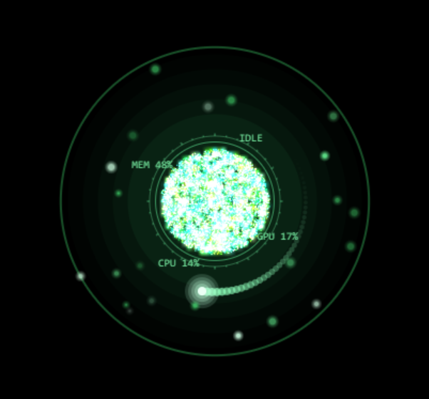

# halden-chief-of-staff

A locally hosted AI chief of staff that runs on a Windows desktop. It types,
it speaks, it listens hands free, it shows a face as a transparent desktop
widget, and it remembers across sessions through a file based memory vault.

Built by **Dr. Reginald Finley**.

The agent runs on Claude Code. The voice, face, memory and gesture components
are open source packages written by Jared Rhodenizer. My work here is the
integration: assembling the stack, writing the agent's operating rules and
persona, tuning the configuration, building a desktop widget that the stack
did not have, and debugging the parts that did not work on this hardware.

**This repository holds my work only.** Jared Rhodenizer's packages are not
redistributed here. `install.ps1` clones them from his repositories at pinned
commits, then copies my modified files over them. The six modified files live
in `overlay/`, each keeping his copyright notice and license header.

## Why it exists

Most assistant setups stop at a chat box. This one was built to hold a working
role. It owns the systems it runs on, it keeps its own memory current, and its
operating rules require it to argue when the reasoning is weak rather than
agree by default. The interesting engineering is in the parts that make a
voice interface usable for long stretches: knowing which microphone to open,
knowing when a sentence has actually ended, and knowing when the speech
recognizer is inventing words out of silence.

## Demo



The ring is a frameless, always on top window with real per pixel
transparency. It idles, listens, thinks and speaks in step with the live voice
line.

## Hardware required

| Part | Why |
| --- | --- |
| Windows 11 machine | The widget and the launchers are Windows specific. The upstream packages also run on macOS and Linux. |
| Microphone | A headset or a USB desk microphone. Headphones matter: with open speakers the agent hears its own voice and interrupts itself. |
| NVIDIA GPU | Optional. Speech recognition runs on CPU without one. |
| Webcam | Optional, for the hand tracking board only. |

## Software required

| Software | Version this runs on |
| --- | --- |
| Python | 3.12.2 |
| git | Required by the install script |
| uv | 0.12.6, used by the voice line |
| Claude Code | The agent runtime, and it must be signed in. See below. |
| PySide6 | 6.11.2, the face widget only |
| psutil | 7.2.2, optional, for the CPU and memory labels |
| nvidia-ml-py | 13.615.71, optional, for the GPU label. NVIDIA only. |
| Chrome | Required by the hand tracking board |
| NVIDIA CUDA runtime | Optional, via the `nvidia-*-cu12` pip wheels |

The upstream packages are pinned to exact commits in the install script, so a
fresh install matches the versions this was built and tested against. The
widget pins its dependencies in `face-widget/requirements.txt`.

The two optional ones only feed the widget's corner labels. Without them the
widget runs exactly as before and those labels show fixed strings instead of
live readings.

### You need your own Claude Code account

This project is everything built around Claude Code. It is not a separate AI.
When you speak, the audio is recorded and transcribed on your own machine, the
text is handed to a Claude Code session, and that session's answer is spoken
back. The thinking step is Claude Code, so it needs your account and an active
login, exactly like any other Claude Code session.

Check that you are signed in before installing anything:

```
claude -p "Reply with exactly: AUTH_OK"
```

`AUTH_OK` means you are set. Anything else, run `claude`, then type `/login`
and follow the browser prompt.

Logins expire. When yours does, every part of this stops answering at once,
including the typed agent and the `/model` command. See Troubleshooting.

## Installation

1. Clone this repository and fetch the upstream packages:

   ```
   git clone https://github.com/YOURNAME/halden-chief-of-staff
   cd halden-chief-of-staff
   powershell -ExecutionPolicy Bypass -File install.ps1
   ```

   On macOS or Linux, run `./install.sh` instead. The face widget is Windows
   only; everything else is cross platform.

   The script clones `backtalk`, `ai-visualizer`, `barehands`,
   `fullstack-agent` and `ai-memory-vault` at the pinned commits listed under
   Credits, then copies the files in `overlay/` over them. Re-running it is
   safe: a package already present is left alone and only the overlay is
   reapplied. Pass `-Force` to delete and re-clone.

2. Create the voice line environment:

   ```
   cd backtalk
   uv sync
   ```

3. Create the widget environment:

   ```
   cd face-widget
   python -m venv .venv
   .venv\Scripts\pip install -r requirements.txt
   ```

4. Copy each config from `config-examples/` to the component that reads it,
   then edit it:

   ```
   config-examples/backtalk.json.example       ->  backtalk/backtalk.json
   config-examples/ai-visualizer.json.example  ->  ai-visualizer/ai-visualizer.json
   config-examples/barehands.json.example      ->  barehands/barehands.json
   config-examples/face-widget.json.example    ->  face-widget/face-widget.json
   ```

   Every path in those files is a placeholder. `<AGENT_DIR>` is wherever you
   cloned this. `<VAULT_PATH>` is wherever you keep the memory vault, which
   belongs outside this repository.

5. Copy `CLAUDE.md` into your agent folder and fill in the placeholders. It is
   the operating file. Five placeholders need filling in. Four set how the
   agent addresses you:

   | Placeholder | What it is | Example |
   | --- | --- | --- |
   | `{OWNER_NAME}` | Full formal name | `Dr. Jane Okonkwo` |
   | `{OWNER_WRITTEN}` | How it addresses you in text | `Dr. Okonkwo` |
   | `{OWNER_SHORT}` | The informal form | `Jane` |
   | `{OWNER_SPOKEN}` | The spoken form, spelt out | `Doctor Okonkwo` |

   The fifth is `{WEBCAM_DEVICE}`, your webcam as DirectShow names it, used by
   the camera section. Find yours with
   `ffmpeg -list_devices true -f dshow -i dummy`.

   `{OWNER_SPOKEN}` is separate on purpose. An abbreviation ending in a full
   stop is read as the end of a sentence by the speech engine, so the name
   arrives in two pieces with an audible gap. The file also uses he and his
   throughout, and a few sections are written as templates with a note saying
   what to replace. Read it once before using it.

6. Set up the memory vault by following `ai-memory-vault/README.md`, which the
   install script fetched.

7. Optional: copy `.env.example` to `.env` and add an ElevenLabs key.

Then run `fullstack-agent\start.bat`, or `start.bat voice` for the face and
voice without the hand board.

## Configuration

Secrets live in `.env`, which is gitignored. See `.env.example` for the list.
The ElevenLabs API key is the only secret in the stack, and it is optional:
without it the voice line uses a local Kokoro voice that needs no account.

The key is never stored in a config file. On Windows it is read from the
`ELEVENLABS_API_KEY` environment variable. On macOS it comes from the Keychain
item `backtalk-elevenlabs`, and on Linux from secret-tool.

Per machine settings live in the four JSON files listed above. They are
gitignored, which is also how upstream treats them, so an update never
overwrites your setup.

## Usage

Typed session, from the agent folder:

```
claude
```

The agent reads its operating file on start and opens with a one line
greeting. Claude Code waits for your first message before it responds, so the
greeting arrives in reply to your first line rather than on launch.

Voice session:

```
fullstack-agent\start.bat voice
```

The face widget and the voice line both start. After the models load it speaks
its greeting and listens. Settings change by spoken phrase during a session:
"push to talk mode", "go hands free", "stop asking for permission", "switch to
the deep model". Say "goodbye" followed by the agent's name to hang up.

## Project layout

What this repository ships:

```
install.ps1           Fetches upstream at pinned commits, applies the overlay
install.sh            The same, for macOS and Linux
overlay/              My six modified files, in their upstream paths
CLAUDE.md             Operating rules and persona, for Claude Code
AGENTS.md             The same file for Codex
face-widget/          Transparent desktop widget. My work.
config-examples/      Placeholder configs for every component
.claude/settings.json Command allowlist for the agent's own harness
.env.example          The one optional secret
```

What the install script adds, fetched from Jared Rhodenizer's repositories and
gitignored here:

```
backtalk/             Voice line
ai-visualizer/        Animated faces
barehands/            Webcam hand tracking board
fullstack-agent/      Launcher
ai-memory-vault/      Memory system
```

## Troubleshooting

The log is `backtalk/logs/backtalk.log`. Read it first. It records what it
heard, what it said, and which microphone it opened.

### It hears me but never answers

The log shows your words transcribed correctly under `[you]`, then no reply
and no error. The face animates, the microphone works, nothing complains.

This is almost always an expired Claude Code login. Check it:

```
claude -p "Reply with exactly: AUTH_OK"
```

If that prints an authentication error instead, run `claude`, type `/login`,
and sign in. Then restart the voice line.

An expired login takes down the typed agent, the `/model` command and the
spoken agent at the same moment, so if all three stopped together, this is
why. It reads as a microphone fault because the transcripts are perfect and
the only broken link is the one that thinks.

Older versions failed silently here. The patched `brain.py` in `overlay/`
speaks the error aloud instead, so you should now hear the reason rather than
guess at it.

### A session ends on its own

Check `backtalk/logs/console.log`. A traceback never reaches `backtalk.log`,
because that file is written by the application's own logger, which an
exception kills on its way past. `console.log` captures stderr instead, with a
banner per launch.

Also worth ruling out: the quit check is a substring match, so any phrase from
`quit_phrases` appearing anywhere in a sentence ends the session. "Hang up" in
the middle of an ordinary remark will do it.

### Nothing is heard at all

Check which microphone it opened. The log names it at startup:

```
[ears] microphone: Microphone (HyperX Quadcast)
[ears] input floor -65 dBFS
```

Windows does not move the default input when you plug in a USB microphone, so
it can quietly listen to the wrong one. Set `mic_device` in `backtalk.json` to
a fragment of the name you want.

A floor near -97 dBFS means the device is muted or its gain is at minimum. A
live microphone in a quiet room reads about -60 to -70.

### It cuts me off mid sentence

Raise `vad_silence_ms` in `backtalk.json`. It is how much silence ends your
turn. Pausing to think costs you the rest of the sentence when it is too low.

### It interrupts itself, or replies to its own voice

Wear headphones, or set `barge_in` to false. There is no echo cancellation, so
on open speakers the microphone hears the agent and treats it as you talking
over it.

### A grey or black square instead of a ring

The widget is pointed at a face that paints a background. Set `face` to
`radial-widget` in `face-widget.json`.

### The console window has vanished

On a multi monitor setup it can open off screen. It is still running. Check
the taskbar, or just launch again: the single instance guard in `start.bat`
clears the old session before starting the new one.

### Stopping it

Say "goodbye" followed by the agent's name, or close the console window.

**Reload face** in the widget menu only redraws the ring. It does not reload
the agent, its settings, its personality file, or your login. After any change
other than the ring's appearance, close and relaunch.

## Credits

Integration, configuration, persona and debugging: **Dr. Reginald Finley**.
That is the work in this repository.

The voice, face, memory and gesture packages are the work of
**Jared Rhodenizer**. I did not write them, and this repository does not
redistribute them. The install script fetches each one from his repository at
the commit my modifications were written against.

| Package | Author | Upstream | Pinned commit | License |
| --- | --- | --- | --- | --- |
| backtalk | Jared Rhodenizer | https://github.com/jaredrhod/backtalk | `17353c66` | AGPL-3.0-or-later |
| ai-visualizer | Jared Rhodenizer | https://github.com/jaredrhod/ai-visualizer | `dd109df7` | AGPL-3.0-or-later |
| barehands | Jared Rhodenizer | https://github.com/jaredrhod/barehands | `bdd8df50` | AGPL-3.0-or-later |
| fullstack-agent | Jared Rhodenizer | https://github.com/jaredrhod/fullstack-agent | `d3c7374c` | AGPL-3.0-or-later |
| ai-memory-vault | Jared Rhodenizer | https://github.com/jaredrhod/ai-memory-vault | `d16ba5a6` | CC BY-SA 4.0 |

His work also includes the four animated faces, the signal bus that links the
face to the voice line, and the spoken console that changes settings mid
session. Go to his repositories for the canonical versions and the full
license text for each.

Other components: Claude Code and the Claude Agent SDK by Anthropic,
faster-whisper and CTranslate2 for speech recognition, Kokoro-82M for local
speech synthesis, webrtcvad and Silero for voice activity detection, MediaPipe
and three.js inside the hand board, Qt and QtWebEngine through PySide6 in the
widget, and the VT323 typeface by The VT323 Project Authors.

## Modifications

My contribution is integration, configuration, persona and debugging. The code
changes below are all of it. The six modified files are in `overlay/`, each
carrying Jared Rhodenizer's copyright notice and license header from the file
it was derived from. The install script copies them over the pinned upstream
checkout.

### New component: face-widget

The stack renders its faces as browser pages. I wanted the face floating over
the desktop, so I wrote `face-widget/widget.py`, a frameless, always on top
PySide6 window with real per pixel transparency. It loads a face from the
running visualizer server, so it rides the same signal bus the browser faces
ride and needs no separate wiring. It carries a tray icon, a right click menu
for size, opacity and position, drag anywhere movement, single instance
locking, and saved positions validated against the monitors that currently
exist.

PySide6 was the choice because the cheaper options fail. pywebview can host
WebView2 in three lines, but its Windows host paints an opaque background
behind the browser that cannot be removed, because WebView2 composites through
DirectComposition and ignores colour keying. Qt renders the page into a
surface it owns, so translucency has something to act on. The reasoning is
written up in `face-widget/README.md`.

This component is entirely mine and depends on nothing of his at the source
level. It talks to his visualizer over HTTP and the file based signal bus.

**Live corner labels.** The widget samples the machine on a background thread
and pushes the readings into the page once a second, which is what makes three
of the four corner labels real. The sampling is deliberately off the UI thread:
psutil and NVML both talk to the operating system and can block for as long as
they like, and anything that blocks the UI thread freezes the ring mid frame. A
stalled reading costs a stale number instead of a stuttering face.

Both libraries are optional. Without them the widget behaves exactly as before
and the labels show their original fixed strings, so a checkout that skips them
is less interesting rather than broken. That matters on a machine with no
NVIDIA card, where NVML does not exist at all.

**Chromium's context menu is switched off** on the web view. It offered Reload,
Save page and View page source, which are meaningless on a face, and it was
racing the widget's own menu for the same right click. Whichever won was luck,
and losing it left no way to reach Quit except the tray icon. The widget now
also handles the menu directly rather than only through an event filter
attached to the web view's private child at startup, so the menu no longer
depends on winning that attachment.

### Visual display: a transparent face

The four faces all paint a full bleed background, which gives an opaque
rectangle in a transparent window. I added
`overlay/ai-visualizer/faces/radial-widget/`, derived from Jared Rhodenizer's
radial face with the background removed. It is a new folder rather than an
edit to his, because the server discovers faces by scanning the folder, so a
new one never collides with an upstream update.

Twelve changes from the original, listed in full in the file's own header: a
transparent background and a move cursor, sound disabled so the voice line
owns the thinking sound, the galaxy backdrop deleted, a clearRect in place of
the background fill, the alert wash confined to a circle instead of covering
the canvas, a semi transparent backing disc behind the orb so it keeps
contrast over a bright desktop, the fullscreen key removed, corner labels
hidden at small sizes, and a scale factor so the drawing fits inside the
canvas instead of overshooting its edges.

**The twelfth is the corner labels.** Upstream draws four fixed strings around
the ring, `NEURAL NET`, `SYS LINK`, `CORE 01` and `AUX FEED`. They are set
dressing and say nothing. Each slot now shows a real value:

| Slot | Shows | Source |
| --- | --- | --- |
| `NEURAL NET` | `IDLE`, `LISTENING`, `THINKING`, `SPEAKING` | `AV.state`, the signal bus the face already reads |
| `SYS LINK` | GPU load | NVML, through the widget |
| `CORE 01` | CPU load | psutil, through the widget |
| `AUX FEED` | Memory in use | psutil, through the widget |

The state label needed no new plumbing at all. The face already reads that
value to animate itself, so it now says in a word what the graphics were
already showing, and it works in a plain browser tab as well as in the widget.

Every slot falls back to its original string when nothing is feeding it, so
this file still renders correctly in a browser with no widget attached, and on
a machine without psutil or an NVIDIA card.

The file keeps his copyright notice and AGPL header. `face.json` beside it is
new, and holds the face's title and description for the gallery.

### Voice line: backtalk

Six fixes, all of them found by debugging a stack that appeared to work.
They touch `config.py`, `ears.py`, `main.py` and `brain.py`.

**Microphone selection.** `mic_device` chooses an input by name fragment, or by
a list of fragments tried in order, and logs the choice. Windows does not move
the default input when a USB microphone is plugged in, so a desk microphone
can sit idle while the laptop's internal one listens. That presents as a
transcription problem rather than a device problem.

**Dead microphone detection.** `check_input_level` samples the input for 400
milliseconds at startup and reports the noise floor. A live condenser in a real
room floors around -60 to -70 dBFS. A muted device reads about -97. Every
downstream signal treats those two cases identically, so a muted microphone
produces an agent that transcribes nothing while appearing healthy.

**CUDA library loading.** `_add_cuda_dll_dirs` puts the pip installed NVIDIA
runtime on the Windows DLL search path. CTranslate2 links cuBLAS and cuDNN by
name, and the `nvidia-*-cu12` wheels install them where Windows does not look.
Without it the open microphone fails with a missing `cublas64_12.dll`, and
nothing else in the error explains why.

**Turn endpointing.** The silence threshold that closes a spoken turn was fixed
at 480 milliseconds in the source. A pause mid sentence was read as the end of
the turn, so sentences arrived in fragments and the agent replied to half of
one. It is now `vad_silence_ms` in the config, alongside `vad_aggressiveness`,
barge in with a level threshold in dBFS, and two guards against speech
recognition hallucinations: a Silero filter so whisper never sees the silence,
and a no speech probability ceiling that discards the caption phrases whisper
writes onto room noise.

**Voice permission gate.** The spoken approval check accepted only exact
phrases, so ordinary spoken approvals failed and were scored as refusals. An
answer now approves when it leads with an affirmative and carries no qualifier
or negation anywhere in it. A qualified yes still goes back for a plain answer,
an unclear answer is asked again rather than denied, and a denial now states
that it is a refusal rather than leaving the model to guess. It had guessed
wrongly, reporting a working calendar connector as unauthorised.

**Silent failures now speak.** A failed turn comes back from the Agent SDK as
one synthetic message carrying an `error` field, with its explanation in
content blocks rather than in the streaming text events. The streaming path is
the only thing that produces speech, so a failure of that shape ended the turn
having said nothing, which looks exactly like an agent that chose not to
answer. An expired login failed every turn in 174 milliseconds this way and
read as a microphone fault for days: the transcripts were perfect, the audio
chain was healthy, and the log recorded the question and no reply.

`ask_stream` now tracks whether a turn produced any speech, surfaces an
error carrying message as a spoken sentence with the error code logged
beside it, and keeps a backstop on the result message for a failure that
never produces a message of its own. The backstop is guarded on the same
flag, so a normal turn is never spoken twice. Diagnosis came from dumping
the raw SDK message stream rather than from reading the symptom, which
pointed at the microphone every time.

This one is in upstream's `brain.py`, which was otherwise unmodified, and it
affects anyone whose session expires mid use. It is worth sending back to him.

### Launcher: fullstack-agent

`start.bat` starts the face widget when one is present and falls back to the
browser visualizer when it is not. It also gained a single instance guard for
the voice line, ported from the upstream shell script, which already had one.
Two voice processes answer the same microphone, and the newer one dies without
saying why.

**It now keeps stderr.** A traceback goes to the console and nowhere else:
`backtalk.log` is written by the application's own logger and never sees an
exception that kills it. So the one message explaining why a session ended
lives only in a console window which, on a multi monitor desk, is routinely
lost off screen. Three sessions ended in one afternoon with no cause recorded
anywhere, for exactly that reason. Stderr is now appended to
`backtalk/logs/console.log` with a timestamped banner per launch, so a crash
stays readable after the next start. Only stderr is redirected, so the live
transcript still reads normally in the window.

### Operating rules and persona

`CLAUDE.md` and `AGENTS.md` are mine. They define the agent's identity, manner,
startup sequence, memory discipline, and the rules that survive context
compaction. The safety rules are the substance: no financial action without
case by case approval, evidence before any claim that something is done,
confirmation before any source edit, full paths named out loud so an approval
can be checked, and external content treated as data rather than as
instructions.

**Three ways to show it something,** none of which needs a connector. Speaking
a URL aloud is unusable, so the operating file gives it three channels, all
built on tools it already has:

| Say | It runs | Then |
| --- | --- | --- |
| "read what I just copied" | `Get-Clipboard` in PowerShell | fetches a URL, or uses the text directly |
| "look at this" | `Graphics.CopyFromScreen` to a temp PNG | reads the image |
| "take a picture" | `ffmpeg -f dshow` for one webcam frame | reads the image |

The `Read` tool displays images, so the capture is the only part that needed
writing. No MCP server, no browser extension, nothing installed beyond ffmpeg.

The constraints matter more than the mechanics, and they are in the file:
captures go to a temp path and never into a project folder, the agent says what
it found before acting so a stale clipboard is caught early, a credential in
the clipboard is reported and never repeated or written anywhere, and the
camera opens on an explicit request only, one frame, never ambiently. The file
also states that a live feed is separate undefined scope rather than an
extension of the single frame rule, so that door is closed deliberately rather
than by omission.

## License

**AGPL-3.0-or-later**, for this repository and for my own contributions in it.

`overlay/` holds modified copies of Jared Rhodenizer's AGPL-3.0-or-later code,
so the whole of this repository carries that license. The `LICENSE` file at the
root is the AGPL-3.0 text.

`ai-memory-vault` is licensed **CC BY-SA 4.0** by its author rather than AGPL.
It is not included here. The install script clones it, and its own `LICENSE`
file governs that directory once fetched.

Using this inside a closed source commercial product is a question for Jared
Rhodenizer, at the address in his repositories.

## Contact

contact@drreginaldfinley.com
